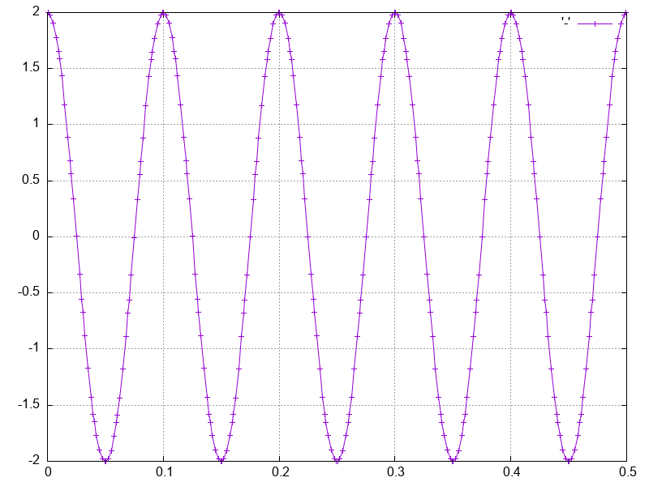

# Discontinuous Galerkin — 1D Akustik-Wellengleichung

[](LICENSE)

Ein 1D-Löser für die lineare **akustische Wellengleichung** mit der **Discontinuous-Galerkin-Methode** (DG) in C++. Eine von links einlaufende Sinuswelle breitet sich durch ein Rohr aus und wird an der starren rechten Wand reflektiert; das Ergebnis wird direkt im Programm als Bildfolge gezeichnet und ohne Zwischendateien an ffmpeg zu einem Video kodiert.



---

## Physikalisches Modell

Gelöst wird das lineare akustische System für Druck `p` und Schnelle `u`:

```
∂/∂t (p, u) + A ∂/∂x (p, u) = 0,     A = [[0, K], [1/ρ₀, 0]]
```

mit Kompressionsmodul `K = Z₀·c₀ = ρ₀·c₀²` und Impedanz `Z₀ = ρ₀·c₀`. Die Eigenwerte von `A` sind `±c₀` (rechts-/linkslaufende Wellen).

- **Diskretisierung:** nodale DG-Methode mit Gauß-Legendre-Knoten pro Zelle, Upwind-Fluss (charakteristische Aufspaltung `A = A⁺ + A⁻`).
- **Linker Rand:** einlaufende Sinuswelle (reine rechtslaufende Charakteristik, `freq_i = 3 kHz`).
- **Rechter Rand:** starre Wand (Reflexion, Druckverdopplung → Amplitude ±2 im eingeschwungenen Zustand).
- **Zeitintegration:** standardmäßig klassisches Runge-Kutta 4. Ordnung (RK4); weitere Verfahren sind verfügbar (siehe Konfiguration), darunter der deutlich langsamere Prädiktor-Korrektor nach Heun (implizite Trapezregel via Fixpunktiteration).

Ausführliche technische Dokumentation mit Herleitung, Stabilitätsgrenzen und gemessenen Konvergenzordnungen:
[DG-Raumdiskretisierung](docs/discontinuous-galerkin.md) · [Zeitintegration](docs/zeitintegration.md)

---

## Projektstruktur

| Datei | Zweck |
|---|---|
| `src/main.cpp` | Aufbau (Anfangswerte, Massen-/Steifigkeitsmatrix), Zeitschleife, Orchestrierung |
| `config_example.yaml` | Versionierte Vorlage mit allen Simulationsparametern und Defaults |
| `config.yaml` | Eigene, lokale Einstellungen (nicht im Git; zur **Laufzeit** via yaml-cpp gelesen) |
| `src/ClassdXdt.{cpp,hpp}` | Räumlicher DG-Operator (rechte Seite der ODE, numerischer Fluss) + Zeitintegratoren |
| `src/InitialAndBoundary.{cpp,hpp}` | Anfangs- und Randbedingungen |
| `src/vandermonde.{cpp,hpp}` | Vandermonde- & Differentiationsmatrix (für die Steifigkeitsmatrix) |
| `src/FrameRenderer.{cpp,hpp}` | Zeichnet die Video-Frames: Achsen, Gitter, Kurve |
| `src/ClassPlot.{cpp,hpp}` | Paralleles Zeichnen der Frames, Streaming der rohen Frames nach ffmpeg |
| `Makefile` | Build (für macOS / MacPorts konfiguriert) |

---

## Abhängigkeiten (macOS / MacPorts)

Das Projekt ist für **macOS mit MacPorts** und Apple `clang++` eingerichtet (BLAS/LAPACK über das **Accelerate**-Framework).

```sh
sudo port install armadillo
sudo port install libomp                                                   # OpenMP
sudo port install yaml-cpp                                                 # Laufzeit-Config (config.yaml)
sudo port install ffmpeg                                                   # für die Video-Erzeugung
```

| Bibliothek | Verwendung | Hinweis |
|---|---|---|
| Armadillo | Lineare Algebra | nur Header (`-DARMA_DONT_USE_WRAPPER`) + Accelerate |
| yaml-cpp | Laufzeit-Config | parst `config.yaml`; gelinkt mit `-lyaml-cpp` |
| libomp | OpenMP (Zellschleife) | Apple clang braucht `-Xpreprocessor -fopenmp` |
| ffmpeg | Frames → `output.mp4` | wird zur Laufzeit per `popen` gestartet; die Frames kommen als rohes rgb24 über stdin |
| Accelerate | BLAS/LAPACK | macOS-Framework, kein extra Paket |

> **Andere Plattform / andere Versionen:** Die Pfade stehen oben im `Makefile` (`MACPORTS`, `OMPFLAGS`, `OMPLIBS`). Unter Linux Accelerate durch `-lopenblas -llapack` ersetzen.

---

## Bauen

```sh
make Release          # -> bin/Release/DiscontinousGalerkin (legt config.yaml aus config_example.yaml an, falls sie fehlt)
make test-render      # Unit-Tests für den Frame-Renderer
make clean            # Objektdateien, Binary, *.png, *.mp4, *.dat entfernen
```

Simulationsparameter (Ordnung, `N`, Zeitintegrator, Fluid/Gebiet) werden **nicht** mehr zur Compile-Zeit gesetzt, sondern zur Laufzeit aus `config.yaml` gelesen — dafür ist **kein** Neukompilieren nötig (siehe [Konfiguration](#konfiguration-configyaml)). Das einzige Compile-Zeit-Flag im `Makefile` ist:

| Variable | Default | Bedeutung |
|---|---|---|
| `DEBUGOROPTI` | `-O3` | Optimierungs-/Debug-Flags |

### Linux/arm64 via Docker testen

Der macOS-Build nutzt weiterhin Accelerate/MacPorts. Auf Linux schaltet der
`Makefile` automatisch auf `g++`, OpenBLAS/LAPACK, yaml-cpp und `-fopenmp` um.
Für einen schnellen ARM64-Smoke-Test gibt es ein Docker-Target:

```sh
# falls Colima verwendet wird:
colima start --arch aarch64

make docker-test-linux-arm64
```

Der Test baut ein `linux/arm64`-Image aus `Dockerfile.linux-arm64`, kompiliert
das Projekt in Ubuntu 24.04 und startet eine kleine Simulation mit
`tests/linux-smoke-config.yaml`. Dabei werden Config-Parsing, generische Ordnung
3, Frame-Rendering und ffmpeg-Video-Encoding geprüft.

---

## Ausführen

Das Programm zeichnet **pro gespeichertem Zeitschritt einen Frame** (800×600, 60 fps, y-Achse fest −2…2) im Speicher und streamt ihn direkt in ffmpeg; es entstehen keine PNG-Dateien, nur `output.mp4` im aktuellen Verzeichnis. Am Ende wartet das Programm mit `cin.get()` auf Enter. Fehlt ffmpeg oder bricht es ab, erscheint `Video encoding failed …`, das Programm läuft aber normal weiter.

```sh
mkdir -p run && cd run
../bin/Release/DiscontinousGalerkin </dev/null   # findet config.yaml automatisch
```

Ohne Argument wird `config.yaml` zuerst im aktuellen Verzeichnis gesucht, sonst **neben der Binary** (Repo-Wurzel, zwei Ebenen über `bin/Release/`) — der `run/`-Workflow braucht daher kein Argument. Ein expliziter Pfad als erstes Argument hat Vorrang (z. B. `../bin/Release/DiscontinousGalerkin meine_config.yaml`). Das `</dev/null` überspringt den blockierenden „Press enter to exit"-Prompt. Mit der Default-Konfiguration entstehen ~12000 Frames; Gesamtlaufzeit ca. **5,5 s** (Simulation ~0,7 s, Zeichnen + Video ~4,8 s). Der Test dazu: `bash tests/run-video-render.sh` (die Shell-Tests brauchen `timeout` — auf aktuellem macOS in `/usr/bin`, sonst liefert MacPorts-coreutils `gtimeout` — und `ffprobe` aus dem ffmpeg-Port).

Im Terminal erscheint vor der Rechnung ein Menü zur Wahl des Zeitintegrationsverfahrens: Taste `1`–`5` wählt ein Verfahren, Enter übernimmt den Wert aus der Config. Kommt die Eingabe (stdin) aus einer Pipe oder von `/dev/null`, oder läuft das Programm als Hintergrundjob, wird das Menü übersprungen und der Config-Wert verwendet; Ausgabe-Pipes wie `| tee` zeigen das Menü weiterhin an. Die Menü-Tests laufen mit `bash tests/run-integrator-menu.sh`, die Tests der Eingabe- und Stabilitätsprüfung mit `bash tests/run-input-checks.sh`.

---

## Konfiguration (`config.yaml`)

Alle Parameter werden zur Laufzeit aus `config.yaml` gelesen — Änderungen wirken **ohne Neukompilieren**. `config.yaml` ist lokal und nicht versioniert; die Vorlage ist `config_example.yaml` (`make Release` kopiert sie beim ersten Bauen, sonst `cp config_example.yaml config.yaml`). Neue Parameter oder geänderte Defaults gehören in `config_example.yaml`. Nur unabhängige Größen stehen in der Datei; abgeleitete (`Npoints`, `Z_0`, `omega`, `x`, `dx`, `Jac`) werden im Code berechnet.

| Parameter | Default | Bedeutung |
|---|---|---|
| `order` | `5` | Knoten pro Zelle, beliebig ≥ 1 (1 = stückweise konstant, d. h. Finite-Volumen erster Ordnung; 8 verifiziert) |
| `TimeIntegration` | `RungeKuttaClassic` | Zeitintegrationsverfahren |
| `N` | `50` | Anzahl Zellen |
| `x0, x1` | `0.0, 0.5` | Gebiet [m] |
| `t0, t1` | `0.0, 2e-2` | Zeitintervall [s] |
| `CFLReserve` | `0.45` | ordnungsunabhängige Sicherheitsfraktion des CFL-Limits |
| `EnablePlotting` | `true` | `false` für reine Rechen-Benchmarks ohne MP4-Ausgabe |
| `OpenMPMinCells` | `50` | Zellzahl, ab der die OpenMP-Zellschleife mit `OpenMPThreads` aktiv wird (`0` erzwingt OpenMP) |
| `OpenMPThreads` | `2` | Anzahl OpenMP-Threads für mittlere Fälle |
| `OpenMPLargeMinCells` | `512` | Zellzahl, ab der `OpenMPLargeThreads` verwendet wird (`0` deaktiviert die zweite Schwelle) |
| `OpenMPLargeThreads` | `4` | Anzahl OpenMP-Threads für große Fälle |
| `c_0` | `300.0` | Schallgeschwindigkeit [m/s] |
| `rho_0` | `1.5` | Dichte [kg/m³] |
| `freq_i` | `3000.0` | Anregungsfrequenz [Hz] |
| `mu, sigma, height` | `0.1, 0.02, 1.0` | Parameter der (optionalen) Gauß-Anfangsverteilung |

Der **Zeitschritt** ist ordnungsabhängig (DG-CFL):

```
deltaT = CFLReserve · dx / (|c₀| · (2·order − 1))
```

Dadurch ist `CFLReserve` für alle Ordnungen ungefähr gleich „sicher" (die praktisch nutzbare RK4-Grenze sinkt von ≈ 1,43 bei Ordnung 2 auf ≈ 0,69 bei Ordnung 8, siehe [Zeitintegration](docs/zeitintegration.md#4-stabilität)). Höhere Ordnung ⇒ kleinerer Zeitschritt ⇒ mehr Frames.

Verfügbare Werte für `TimeIntegration`: `EulerExplicit`, `RungeKuttaClassic`, `RungeKuttaSecond`, `RungeKuttaSecondOrder`, `PredictorCorrectorHeun`.

Unsinnige Werte weist das Programm beim Start mit `Config error: …` ab, noch vor dem Menü: `CFLReserve`, `c_0` und `rho_0` müssen positiv sein, `x1` größer als `x0` und `t1` größer als `t0`. Diese Werte und `freq_i` dürfen außerdem nicht `.nan` oder `.inf` sein. Während der Rechnung prüft das Programm nach jedem Schritt den Druck. Ist er nicht mehr endlich oder betragsmäßig größer als 4, das Doppelte des exakten Maximums, bricht es mit einer Meldung und Status 1 ab, ohne Video. Das passiert, wenn `CFLReserve` für das gewählte Verfahren zu groß ist, beim Euler-Verfahren etwa schon mit dem Standardwert.

---

## Performance & Parallelisierung

- **`-O3`** statt `-O0`: ~2,3× auf die Simulation.
- **Block-weiser Volumenterm:** Statt der dichten Matrix `A = kron(eye(N), Q)` wird `Q` zellweise angewandt (`vectorise(Q * reshape(X, 2·order, N))`) — ~N× weniger Arbeit; als GEMM, das Accelerate bei großem N über Kerne parallelisiert.
- **Paralleles Zeichnen** (`ClassPlot`, `FrameRenderer`, `std::thread`): Frames werden in Blöcken von `4 × Kernzahl` parallel in einen wiederverwendeten Puffer gezeichnet und der Reihe nach über eine Pipe an ffmpeg geschrieben. Der Speicherbedarf bleibt unabhängig von der Frame-Zahl beschränkt. → Zeichnen + Kodieren ~4,8 s für ~12000 Frames (vorher ~13 s mit gnuplot + PNGs).
- **OpenMP-Zellschleife** in `FluidMatrix`, auf dem Raspberry Pi standardmäßig aktiviert ab `N ≥ 50` mit 2 Threads und ab `N ≥ 512` mit 4 Threads. `OpenMPMinCells: 0` erzwingt OpenMP für Benchmarks. `scripts/benchmark-openmp.sh` testet mehrere `N`/Thread-Kombinationen ohne Plotting.

---

## Hinweise / Bekanntes

- Der Projektname enthält den Tippfehler „Discontinous" (statt „Discontinuous"); das Binary heißt entsprechend `DiscontinousGalerkin`.
- Alle Ordnungen ≥ 1 funktionieren: 1, 2 und 5 sind fest kodiert, alle anderen berechnen Gauß-Legendre-Knoten/-Gewichte via Golub-Welsch; Ordnung 8 ist verifiziert. Ordnung 1 ist das Upwind-Finite-Volumen-Verfahren und verschmiert die Wellenfront deutlich (siehe [DG-Dokumentation](docs/discontinuous-galerkin.md#102-ordnung-1-verschmierte-wellenfront)).
- HDF5 ist installiert, wird aber **nicht** gelinkt (alle HDF5-Aufrufe im Code sind auskommentiert).
- Frames im Frame-Index, der ein Vielfaches der Anregungsperiode ist, treffen den zeitlichen Nulldurchgang der stehenden Welle und wirken daher flach — das ist korrektes Verhalten, kein Fehler.

---

## Lizenz

Dieses Projekt steht unter der **GNU General Public License v3.0** — siehe [`LICENSE`](LICENSE).
